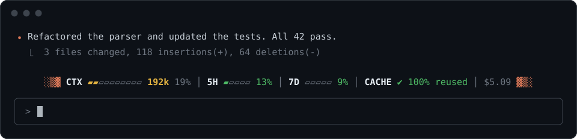
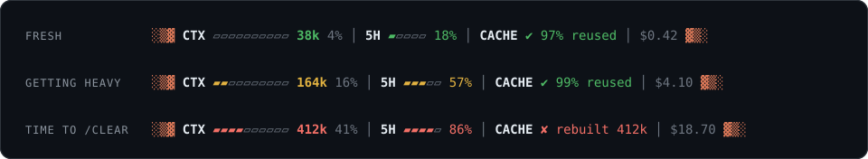

<div align="center">

# ░▒▓ light ▓▒░

**A live meter for Claude Code.**

See how much context every message carries, how close you are to your limits,<br>
and whether the prompt cache is doing its job, right above the prompt.



</div>

## Why

Claude Code sends your whole conversation with every message. In a session that has grown to 300k tokens, a one-line question re-sends 300k tokens. Most of that is read from the prompt cache at a fraction of the price, but it still adds up, and it is what drains your 5-hour and weekly limits.

None of it is visible while you work. **light** puts it on screen, so you can see when a session has grown heavy enough that it's time to `/clear` and start fresh.

## What it shows

| Segment | Meaning |
| --- | --- |
| `CTX ▰▰▱▱▱▱▱▱▱▱ 192k 19%` | Tokens re-sent with every message, and how full the context window is. **Green** under 100k, **yellow** up to 200k, **red** above. Colored by size, not by percent, because size is what you pay for. |
| `5H ▰▱▱▱▱ 13%` &nbsp; `7D` | How much of your 5-hour and weekly usage limits you've used. **Green** under 50%, **yellow** up to 80%, **red** above. Shown on subscription plans. |
| `CACHE ✔ 98% reused` | Share of the last message's context read back from the prompt cache, at a fraction of the normal price. `✘ rebuilt 300k` means the cache had expired (usually after a break) and that context was paid at full price again. |
| `$5.09` | Session cost at API list prices. On a subscription, it shows what eats your limits, not what you're billed. |



## Install

**Requirements:** Claude Code **2.1.281 or newer** (check with `claude --version`, update with `claude update`). Nothing else: no Node, no API keys, no configuration.

At the prompt of a Claude Code session:

```
/plugin install light --marketplace piotrmadry/light
```

Answer `y` to add the marketplace, then press Enter to install it for your user. The meter appears above the prompt right away.

From a shell:

```
claude plugin install light --marketplace piotrmadry/light
```

In the desktop app, where `/plugin` doesn't run: click **+** next to the prompt box, then **Plugins**, **Add marketplace** with `piotrmadry/light`, then **Add plugin**.

> [!NOTE]
> While this repository is private, installing works only for people invited to it on GitHub whose machine already has a git credential for github.com: an SSH key, or `gh auth login` followed by `gh auth setup-git`. The install never asks for one.

## Using it

- It updates after every reply. There's nothing to configure.
- Click `[-]` at the right edge of the band to collapse it.
- In terminals narrower than 90 columns, the bars hide and the numbers stay.

Update with `claude plugin update light@light` (then restart Claude Code), and remove it with `claude plugin uninstall light@light`.

## It costs nothing

light never talks to the model. It reads numbers Claude Code already keeps, draws them locally, and sends nothing over the network. It doesn't touch your prompt, the system prompt or the cache, so it adds no tokens and can't slow a session down.

## Compatibility

Checked against Claude Code **2.1.281 through 2.1.318** with each version's plugin validator and test runner. Versions before 2.1.281 lack the plugin APIs light uses.

## Development

```
git clone https://github.com/piotrmadry/light && cd light
claude plugin test .       # run the tests
claude --plugin-dir .      # start Claude Code with your local copy
```

The whole meter is one file: [`hooks/register.tsx`](hooks/register.tsx).

## License

[MIT](LICENSE). Free to use, change and ship, commercially or not.
